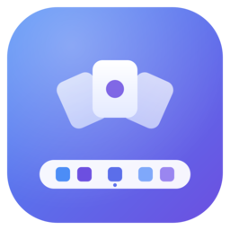
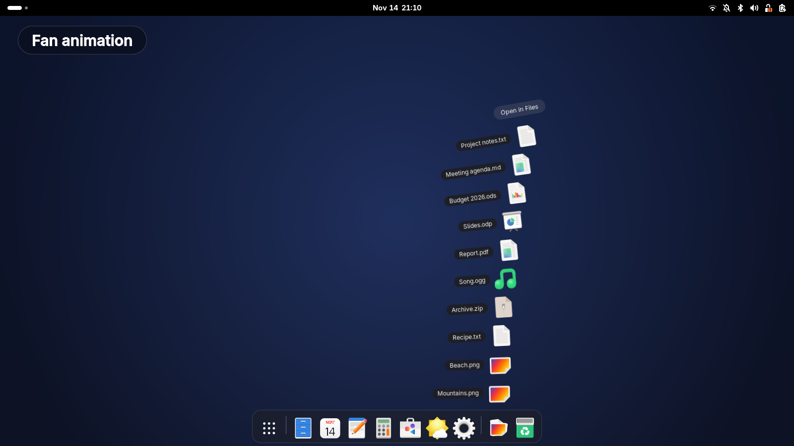
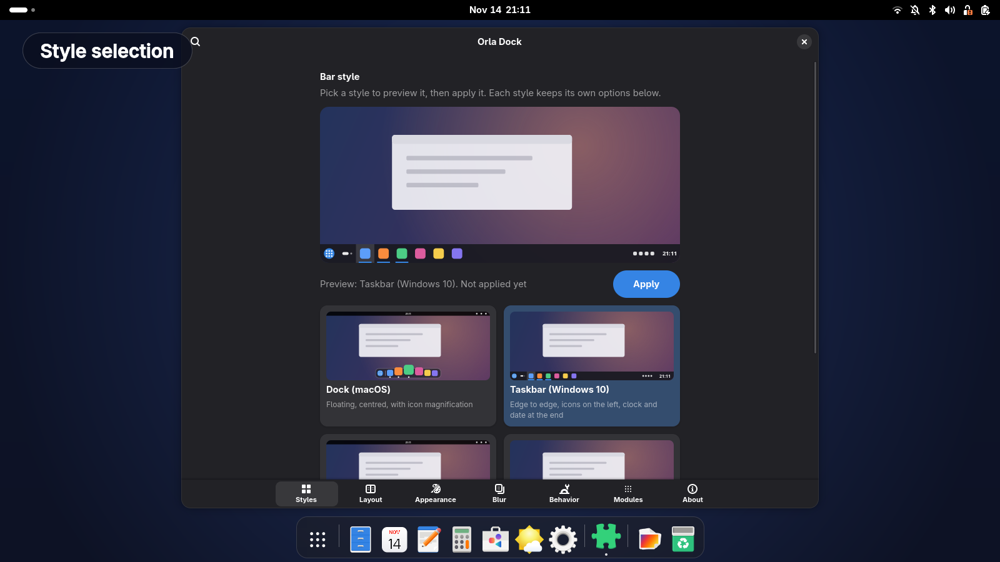
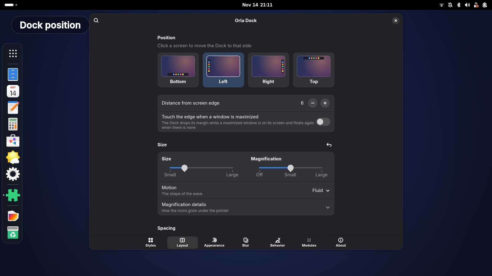
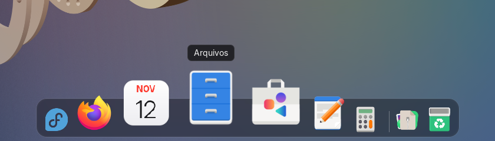

<p align="center"></p>

# Orla Dock

**A dock for GNOME Shell with fan-style folder stacks, four bar styles you can preview before applying, and a clickable position picker. It can also drop its margin and touch the screen edge while a window is maximized.**

| Fan animation | Style selection | Dock position |
| --- | --- | --- |
|  |  |  |

## Description

Orla Dock is a native GNOME Shell extension inspired by the macOS Dock. Folders on the dock open as a fan of files that rises from the icon, and the fan folds back into the icon along the same path when it closes. Icons magnify in a smooth wave as the pointer moves over them.

Choose between four bar styles: a macOS-style dock, a Windows 10-style taskbar, a dock modelled on the GNOME dash and a Windows 7-style taskbar. Each style shows a preview before you apply it. In the taskbar styles, the GNOME top bar can be merged into the taskbar, bringing the clock, tray, indicators and Activities with it; switching back to a dock style restores the top bar.

Place the dock at the bottom, top, left or right by clicking a preview of each side. An optional setting lets the floating dock drop its margin and touch the screen edge while a maximized window is on its monitor, and float again when there is none. Every setting applies instantly.

---

## Em português

Uma dock para o GNOME Shell inspirada na Dock do macOS: ampliação dos ícones em onda, efeito Gênio, Stacks, Lixeira, auto-ocultar, miniaturas ao vivo e muito mais. Também vira uma **barra de tarefas no estilo do Windows 10 ou 7**. É uma extensão nativa: todo o código roda dentro do GNOME Shell, sem processos externos.




| Stack em leque | Stack em grade | Preferências | Sobre |
| --- | --- | --- | --- |
|  |  |  |  |

## Recursos

**Quatro estilos**, escolhidos com prévia (como na Luma Dock: clique num cartão para ver e depois em "Aplicar")
- **Dock (macOS):** flutuante, centralizada, com ampliação em onda.
- **Barra de tarefas (Windows 10):** de ponta a ponta, ícones à esquerda, destaque do app em foco, sublinhado nos apps abertos, alerta laranja quando um app pede atenção.
- **Dock (GNOME):** flutuante como a Dash do GNOME, sem ampliação, botão de aplicativos no fim e destaque arredondado em volta do ícone.
- **Barra de tarefas (Windows 7):** barra de vidro, botão Iniciar redondo e apps abertos com moldura de botão.
- Nas barras de tarefas, a **barra superior do GNOME se junta à de baixo**: relógio, bandeja, indicadores e Atividades passam para ela e a barra de cima some (volta ao normal nos estilos de dock).
- **Posição escolhida clicando na prévia** de cada lado da tela.
- **Encostar na borda com janela maximizada** (opcional): a dock perde a margem enquanto houver janela maximizada e volta a flutuar quando não houver.

**Aparência e animações**
- Cantos arredondados e transparência.
- **Vidro (desfoque)** com os mesmos controles da Luma Dock: modo dinâmico (o que está atrás da dock) ou estático (imagens prontas ou sua foto), visuais prontos (Cristal, Fosco, Vívido, Meia-noite), tom, intensidade, vibração, brilho e luz na borda com direção.
- Temas prontos (Sistema, Cor personalizada com gradiente, Cor do papel de parede, Carbon, Nord, Catppuccin, Gruvbox, Dracula, Tokyo Night, Frost).
- Vidro ajustável: intensidade, brilho, vibração e brilho na borda; contorno, espaçamento e preenchimento.
- Ampliação em onda **suavizada a cada quadro** (os vizinhos crescem junto), com ajustes de suavidade, alcance e elevação, nas 4 posições.
- **Movimentos da ampliação** iguais aos da Luma Dock: Fluido, Dominó, Cilindro, Magnético, Gelatina e Coverflow, com "Abrir espaço", força do empurrão e ajustes próprios de cada movimento.
- Indicadores em ponto, traço, linha, quadrado ou um ponto por janela, com cor automática, de destaque ou personalizada.
- Ícone do Calendário com a data de hoje.
- Ícones entram e saem com animação; quicam ao abrir um app e quando uma janela pede atenção.
- Indicadores de apps abertos, nome do app ao passar o mouse e reflexo opcional dos ícones.
- Efeitos de minimizar **Gênio** (malha deformável, bordas lisas) e **Escala**, com duração ajustável (100 a 1500 ms), entrando no ícone do app ou numa miniatura própria ao lado do Downloads e da Lixeira. Como na Luma Dock, o Gênio persegue o ícone quadro a quadro (inclusive ampliado), a miniatura surge só quando a janela termina de entrar e some na hora ao restaurar.
- Segue o estilo claro/escuro do sistema.
- **Janelas balançando** (wobbly windows), sem precisar de outra extensão: ao arrastar, redimensionar e (opcional) maximizar/restaurar, com intensidade Suave, Normal ou Forte e ajustes de mola, atrito, massa e malha. Se a extensão “Compiz windows effect” estiver ativa, a Orla deixa o efeito com ela.

**Aplicativos**
- Apps fixados compartilhados com os favoritos do GNOME, mais apps abertos e uma seção opcional de recentes/sugeridos.
- Botão de aplicativos com o logo do sistema (padrão), grade, bloco colorido ou imagem personalizada, separado dos apps por uma divisória (opcional).
- Botão direito na divisória ou no fundo: posição na tela, estilo, ocultação, ampliação e configurações.
- Um clique abre, traz para frente, alterna entre janelas ou minimiza. O botão do meio abre uma nova janela, e a rodinha do mouse alterna entre janelas.
- Menu de contexto com a lista de janelas, as ações do `.desktop` (ex.: "Nova janela privada"), Manter no Dock, Mostrar todas as janelas, Ocultar e Encerrar.
- Arrastar para reordenar, arrastar para fora para remover (com "fumacinha") ou soltar sobre a lixeira.
- Miniaturas ao vivo das janelas.
- Contadores de notificação por app (notificações do GNOME ou Unity LauncherEntry), inclusive em apps fixados e fechados, e barra de progresso.
- **Janelas ocultas:** padrões de classe de janela (com `*`) que a dock ignora.

**Recursos do macOS**
- Stacks em grade, leque ou lista.
- **Locais:** Pasta pessoal, Downloads, Documentos, Imagens, Vídeos e Música, cada um com o seu liga/desliga, além de outras pastas a gosto.
- **USB e outras unidades** aparecem só enquanto estão conectadas (com Ejetar/Desmontar).
- Lixeira com ícone cheio/vazio, Abrir e Esvaziar.
- Uma dock independente por monitor; posição inferior, superior, esquerda ou direita.
- Tamanho dinâmico (encolhe quando não cabe) e redimensionamento arrastando a divisória.
- Atalho **Super+Alt+D** para ligar/desligar o auto-ocultar (configurável).

## Compatibilidade

- GNOME Shell 51 (testado) e 50 (declarado, não testado)
- Wayland, com suporte a escala fracionária/HiDPI
- Convive com Blur my Shell (sem blur duplicado), Just Perfection e AppIndicator

## Instalação (a partir do código-fonte)

Dependências no Fedora:

```sh
sudo dnf install git glib2-devel gettext mutter-devkit
```

Clonar e instalar:

```sh
git clone git@github.com:viniciusbispo19/orla-dock.git ~/Projetos/orla-dock
cd ~/Projetos/orla-dock
./scripts/install.sh
```

No Wayland, o GNOME Shell só detecta extensões novas depois de sair da sessão e entrar de novo. Depois disso:

```sh
gnome-extensions enable orla-dock@viniciusbispo19
```

Para abrir as preferências:

```sh
gnome-extensions prefs orla-dock@viniciusbispo19
```

## Desenvolvimento

| Script | O que faz |
| --- | --- |
| `scripts/install.sh` | Compila o schema e as traduções e instala o link simbólico |
| `scripts/nested.sh` | Abre uma sessão GNOME de teste numa janela (`gnome-shell --devkit`) |
| `scripts/update-po.sh` | Extrai os textos traduzíveis e atualiza `po/*.po` |
| `scripts/pack.sh` | Gera o pacote `.zip` em `dist/` |

Logs da sessão principal:

```sh
journalctl -f -o cat /usr/bin/gnome-shell
```

Logs da janela de preferências:

```sh
journalctl -f -o cat /usr/bin/gjs
```

### Organização do código

| Arquivo | Responsabilidade |
| --- | --- |
| `extension.js` | Ponto de entrada: `enable()` cria o `DockManager`, `disable()` o destrói |
| `lib/dockManager.js` | Uma dock por monitor; configurações, atalho, Dash da Visão Geral, geometria do minimizar |
| `lib/dock.js` | A dock de um monitor: layout, ampliação, rótulo, menus, arrastar e soltar |
| `lib/dockItem.js` | Base de todos os itens e o separador redimensionável |
| `lib/appIcon.js` | Ícone de app, botão da grade de apps e janela minimizada |
| `lib/appTracker.js` | Modelo: quais apps aparecem e em que ordem |
| `lib/appMenu.js` | Menus de contexto |
| `lib/magnification.js` | Matemática da ampliação em onda |
| `lib/magnifier.js` | Motor da ampliação: suavização a cada quadro |
| `lib/themes.js` | Temas e cores (CSS do fundo, contorno, brilho) |
| `lib/wallpaperColor.js` | Cor predominante do papel de parede |
| `lib/calendarIcon.js` | Ícone do Calendário com a data de hoje |
| `lib/styles.js` | **Registro único dos estilos de barra** (para criar um estilo, basta acrescentar um objeto aqui) |
| `lib/genieMath.js` | Matemática do efeito Gênio (testável fora do Shell) |
| `lib/mounts.js` | Unidades USB e outras |
| `lib/panelMerge.js` | Junta a barra superior do GNOME na barra de tarefas |
| `lib/maximizeWatcher.js` | Detecta janela maximizada (encostar na borda) |
| `lib/notificationCounter.js` | Notificações do GNOME por app |
| `lib/windowFilter.js` | Janelas ocultas |
| `lib/taskbarClock.js` | Relógio com data do modo barra de tarefas |
| `lib/animations.js` | Quique e "fumacinha" |
| `lib/minimizeEffects.js` | Efeitos Gênio e Escala |
| `lib/wobbly.js` | Janelas balançando: sinais do Mutter e o efeito de deformação |
| `lib/wobblyMath.js` | Física das janelas balançando (malha de molas, testável fora do Shell) |
| `lib/autohide.js` | Auto-ocultar e reserva de espaço (struts) |
| `lib/blur.js` | Blur nativo com cantos arredondados |
| `lib/stacks.js` | Stacks (grade, leque, lista) |
| `lib/trash.js` | Lixeira |
| `lib/windowPreviews.js` | Miniaturas ao vivo |
| `lib/launcherEntry.js` | Contadores e progresso via D-Bus |
| `lib/utils.js` | Eixos (4 posições), timeouts e utilidades |
| `prefs.js`, `prefs/` | Janela de preferências (GTK 4 + libadwaita), uma aba por arquivo; as prévias ficam em `prefs/previews.js` |

## Limitações conhecidas

- **Arquivos arrastados de outros programas:** no Wayland, o GNOME Shell recebe o movimento do arraste, mas não o arquivo. Por isso, parar um arquivo sobre um ícone traz o app para frente (como no Mac) para você soltar direto na janela dele. Arquivos arrastados das Stacks da própria Orla abrem direto no app.
- **Presets do vidro estático:** as imagens prontas da Luma são arte dela; a Orla tem as suas próprias (Abstrato, Aurora, Cyberpunk, Minimalista, Pôr do sol).
- O Gênio usa um detalhe interno do Shell (`Main.wm._minimizing`); se ele mudar numa versão futura, a Orla volta sozinha para a animação nativa.

## Licença

[GPL-3.0-or-later](LICENSE)
