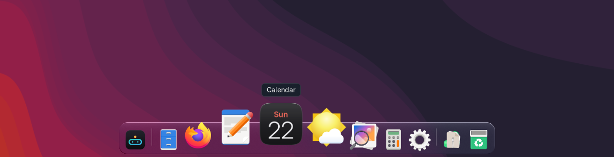
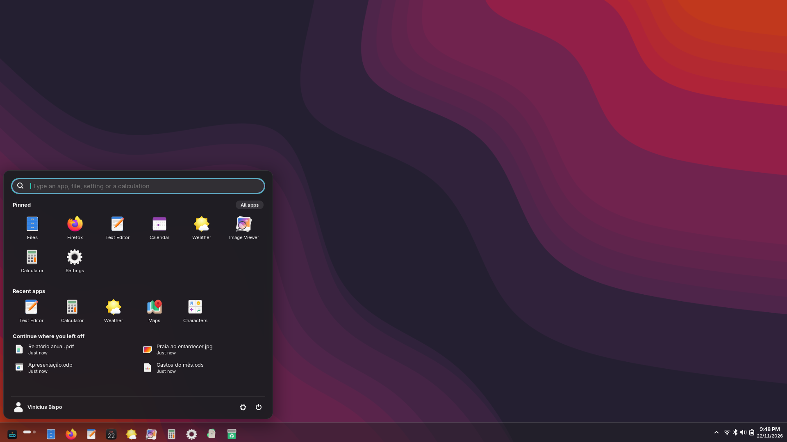
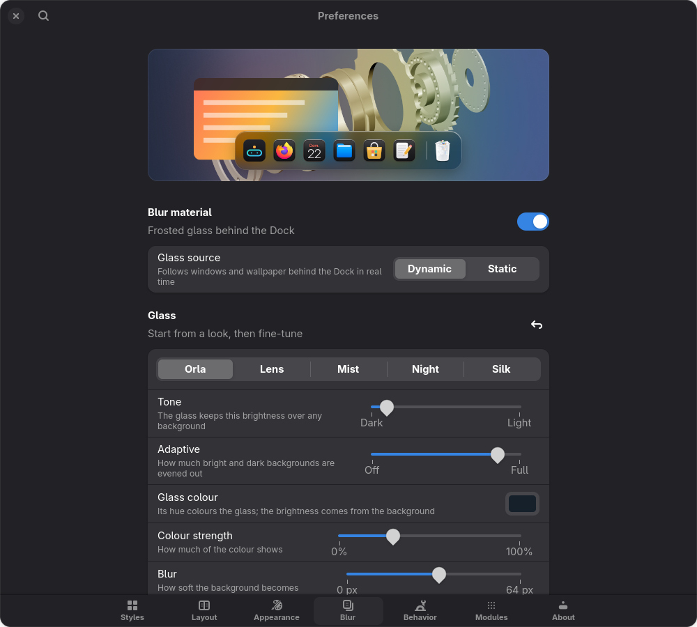
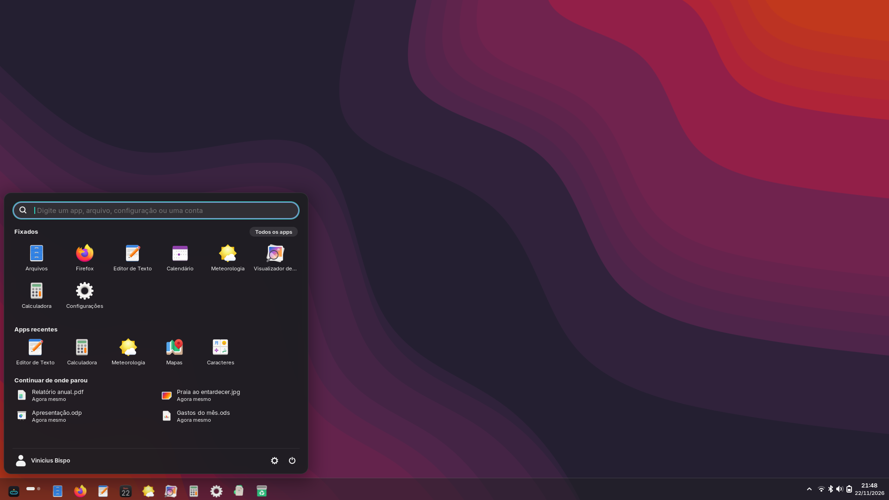
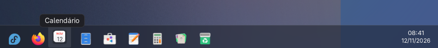
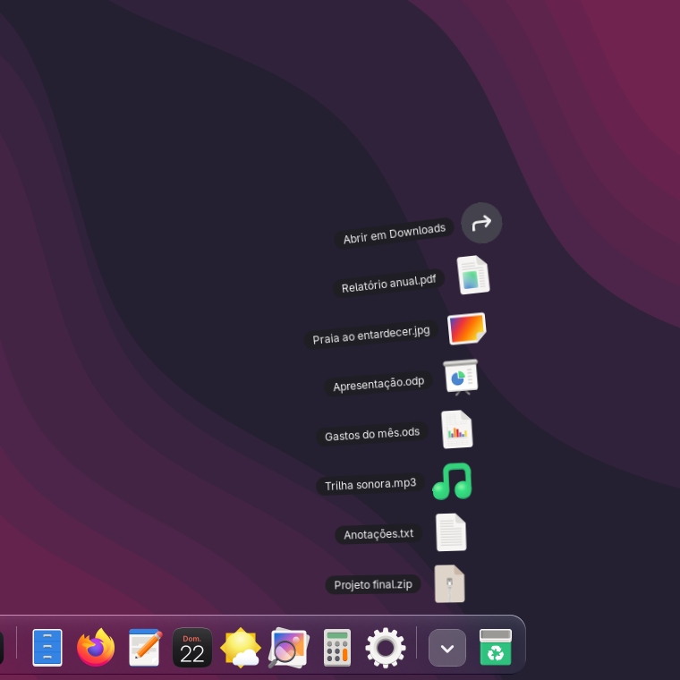
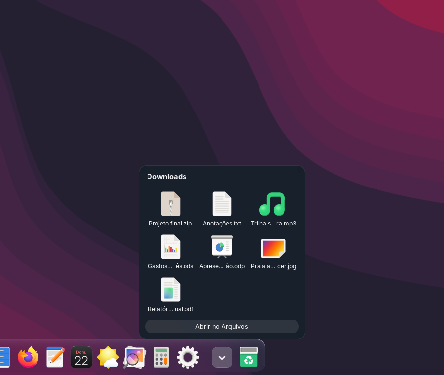
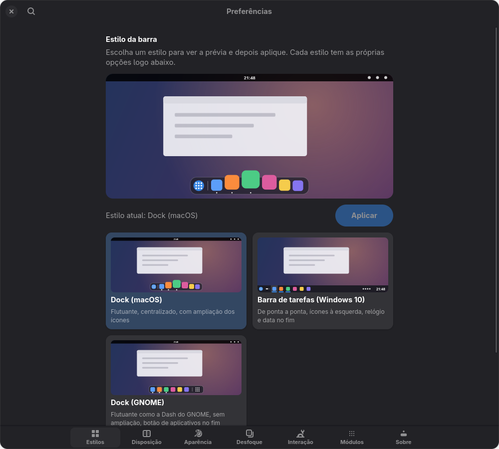
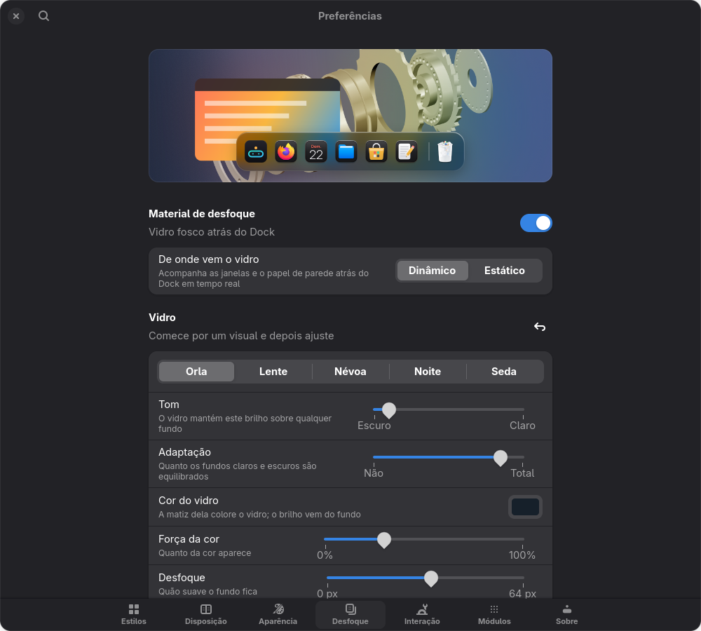
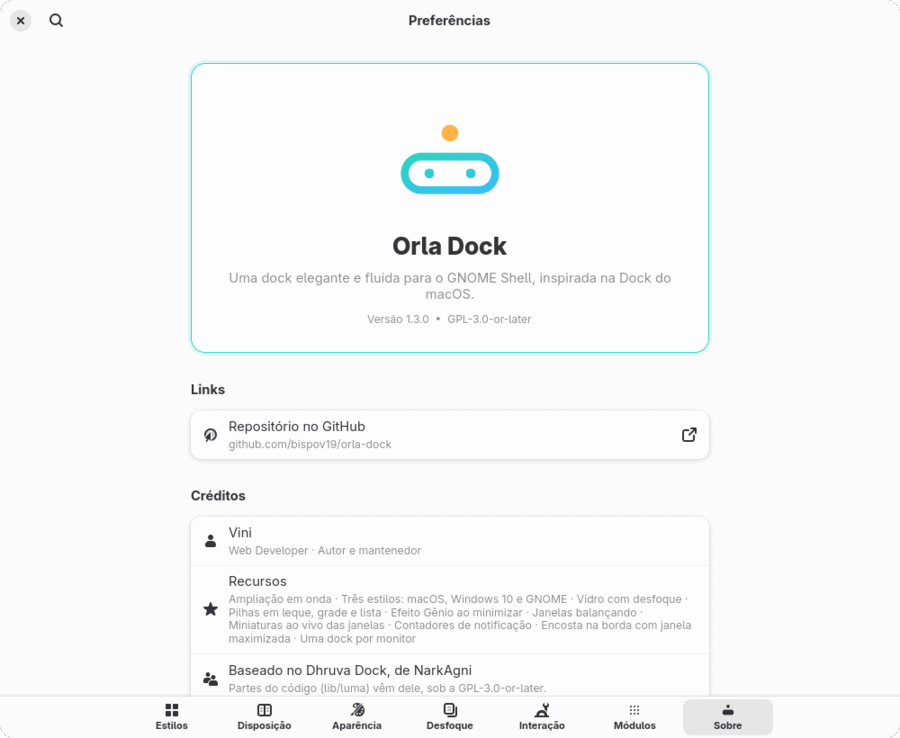

<p align="center"></p>

# Orla Dock

**A dock for GNOME Shell with wave magnification, folder stacks that open as a fan, dock and taskbar styles, a Start Menu and an adaptive frosted glass.**

| Dock with Orla Glass | Taskbar with the Start Menu |
| --- | --- |
|  |  |

| Folder stack as a fan | Glass settings |
| --- | --- |
|  |  |

## Description

Orla Dock is a native GNOME Shell extension inspired by the macOS Dock. Icons magnify in a smooth wave as the pointer moves over them, windows minimize into their icon with a Genie effect, and hovering an app shows live previews of its windows.

Folders on the dock open as stacks: a fan of files that rises from the icon and folds back along the same path, or a grid or a list. Files can be dragged out of a stack onto an app icon, onto the Trash, or onto any window, where they are copied so you can paste them.

Choose between dock and taskbar styles, each shown in a preview before you apply it. In the taskbar, Panel mode brings the GNOME top bar into the bar: workspaces, a tray for other extensions' icons, Quick Settings and the clock, with notifications shown next to it. The Start Menu searches apps, settings, files, other apps' results and the web, does quick calculations and keeps pinned apps, folders and recent files.

Orla Glass is the extension's own frosted material: it adapts to bright and dark backgrounds, bends what is behind its thick edge, and adds a soft sheen and a lit rim. It can follow what is behind the dock or use a still image.

Place the dock on any side of the screen by clicking a preview. An optional setting lets the floating dock touch the screen edge while a window is maximized. Every setting applies instantly.

---

## Em português

Uma dock para o GNOME Shell inspirada na Dock do macOS: ampliação dos ícones em onda, efeito Gênio, Stacks, Lixeira, auto-ocultar, miniaturas ao vivo e muito mais. Também vira uma **barra de tarefas**, com modo Painel e Menu Iniciar. É uma extensão nativa: todo o código roda dentro do GNOME Shell, sem processos externos.






| Pilha em leque | Pilha em grade |
| --- | --- |
|  |  |

| Preferências | Vidro | Sobre |
| --- | --- | --- |
|  |  |  |

## Recursos

**Três estilos**, escolhidos com prévia (clique num cartão para ver e depois em "Aplicar")
- **Dock (macOS):** flutuante, centralizada, com ampliação em onda.
- **Barra de tarefas (Windows 10):** de ponta a ponta, ícones à esquerda, destaque do app em foco, sublinhado nos apps abertos, alerta laranja quando um app pede atenção.
- **Dock (GNOME):** flutuante como a Dash do GNOME, sem ampliação, botão de aplicativos no fim e destaque arredondado em volta do ícone.
- Nas barras de tarefas, o **modo Painel**: a barra de cima entra na de tarefas (indicador de workspaces que troca de área com a rodinha, bandeja com seta onde dá para fixar, mandar para a bandeja e reordenar ícones, configurações rápidas e relógio com data), e os avisos de notificação surgem acima do relógio.
- O **Menu Iniciar**: busca (apps, configurações, arquivos, resultados de outros apps, calculadora, comandos com `>` e web), fixados em páginas com pastas (arraste um app em cima de outro), apps recentes, "Continuar de onde parou", todos os apps em lista ou grade com índice de letras, menu de contexto e energia. Tudo volta ao normal nos estilos de dock.
- **Posição escolhida clicando na prévia** de cada lado da tela.
- **Encostar na borda com janela maximizada** (opcional): a dock perde a margem enquanto houver janela maximizada e volta a flutuar quando não houver.
- **Barra do GNOME embaixo com a dock em cima** (opcional, ligada por padrão): com a dock na posição Superior, a barra do sistema desce para a borda de baixo, os menus dela abrem para cima e os avisos de notificação aparecem abaixo da dock. Ao mudar de posição, bloquear a tela ou desligar a extensão, tudo volta ao lugar.

**Aparência e animações**
- Cantos arredondados e transparência.
- **Vidro da Orla:** um material próprio, no modo dinâmico (o que está atrás da dock) ou estático (imagens prontas ou sua foto). Ele se **adapta** ao brilho do fundo (os ícones ficam legíveis sobre qualquer papel de parede), tem **refração** na borda grossa e curva, **dispersão** (um arco-íris sutil onde a borda curva a luz), **reflexo** vindo de cima, **relevo** na borda (luz de um lado, sombra do outro, com direção) e **granulado** contra faixas em degradês escuros. Visuais prontos: Orla, Lente, Névoa, Noite e Seda. A prévia das preferências usa a mesma conta de cor da dock.
- Temas prontos (Sistema, Cor personalizada com gradiente, Cor do papel de parede, Grafite, Nord, Catppuccin, Gruvbox, Dracula, Tokyo Night, Frost).
- Contorno, espaçamento e preenchimento ajustáveis.
- Ampliação em onda **suavizada a cada quadro** (os vizinhos crescem junto), com ajustes de suavidade, alcance e elevação, nas 4 posições.
- **Movimentos da ampliação**: Fluido, Dominó, Cilindro, Magnético, Gelatina e Coverflow, com "Abrir espaço", força do empurrão e ajustes próprios de cada movimento.
- Indicadores em ponto, traço, linha, quadrado ou um ponto por janela, com cor automática, de destaque ou personalizada.
- Ícone do Calendário com a data de hoje.
- Ícones entram e saem com animação; quicam ao abrir um app e quando uma janela pede atenção.
- Indicadores de apps abertos, nome do app ao passar o mouse e reflexo opcional dos ícones.
- Efeitos de minimizar **Gênio** (malha deformável, bordas lisas) e **Escala**, com duração ajustável (100 a 1500 ms), entrando no ícone do app ou numa miniatura própria ao lado do Downloads e da Lixeira. O Gênio persegue o ícone quadro a quadro (inclusive ampliado), a miniatura surge só quando a janela termina de entrar e some na hora ao restaurar.
- Segue o estilo claro/escuro do sistema.
- **Janelas balançando** (wobbly windows), sem precisar de outra extensão: ao arrastar, redimensionar e (opcional) maximizar/restaurar, com intensidade Suave, Normal ou Forte e ajustes de mola, atrito, massa e malha. Se a extensão “Compiz windows effect” estiver ativa, a Orla deixa o efeito com ela.

**Aplicativos**
- Apps fixados compartilhados com os favoritos do GNOME, mais apps abertos e uma seção opcional de recentes/sugeridos.
- Botão de aplicativos com o logo da Orla Dock (padrão) ou, numa galeria com prévia, o logo do sistema, do Fedora, GNOME, Ubuntu, Debian, Arch Linux, Manjaro, Linux Mint, openSUSE ou elementary OS; também pode ser grade, bloco colorido ou imagem personalizada, separado dos apps por uma divisória (opcional).
- Botão direito na divisória ou no fundo: posição na tela, estilo, ocultação, ampliação e configurações.
- Um clique abre, traz para frente, alterna entre janelas ou minimiza. O botão do meio abre uma nova janela, e a rodinha do mouse alterna entre janelas.
- Menu de contexto com a lista de janelas, as ações do `.desktop` (ex.: "Nova janela privada"), Manter no Dock, Mostrar todas as janelas, Ocultar e Encerrar.
- Arrastar para reordenar, arrastar para fora para remover (com "fumacinha") ou soltar sobre a lixeira.
- Miniaturas ao vivo das janelas.
- Contadores de notificação por app (notificações do GNOME ou Unity LauncherEntry), inclusive em apps fixados e fechados, e barra de progresso.
- **Janelas ocultas:** padrões de classe de janela (com `*`) que a dock ignora.

**Recursos do macOS**
- Stacks em grade, leque ou lista. Como no macOS, enquanto a pilha está aberta o ícone vira um quadrado com a seta para baixo, e o topo do leque mostra "Abrir em Downloads" (o nome da pasta).
- **Arrastar arquivos das Stacks:** solte no ícone de um app para abrir com ele, na Lixeira para apagar, ou sobre a janela de qualquer app: o arquivo é copiado, a janela vem para a frente e é só colar com Ctrl+V (veja as limitações). Solto num lugar vazio, ele volta voando para a pilha. O clique simples continua abrindo o arquivo.
- **Locais:** Pasta pessoal, Downloads, Documentos, Imagens, Vídeos e Música, cada um com o seu liga/desliga, além de outras pastas a gosto.
- **USB e outras unidades** aparecem só enquanto estão conectadas (com Ejetar/Desmontar).
- Lixeira com ícone cheio/vazio, Abrir e Esvaziar.
- Ícone do Downloads em dois estilos, escolhidos pela prévia: **pasta com seta de download** (padrão, SVG próprio) ou **pasta com arquivos** (os mais recentes empilhados).
- Uma dock independente por monitor; posição inferior, superior, esquerda ou direita.
- Tamanho dinâmico (encolhe quando não cabe) e redimensionamento arrastando a divisória.
- Atalho **Super+Alt+D** para ligar/desligar o auto-ocultar (configurável).

## Compatibilidade

- GNOME Shell 51 (Fedora 45, testado)
- Wayland, com suporte a escala fracionária/HiDPI
- Convive com Blur my Shell (sem blur duplicado), Just Perfection e AppIndicator

## Instalação (a partir do código-fonte)

Dependências no Fedora:

```sh
sudo dnf install git glib2-devel gettext mutter-devkit
```

Clonar e instalar:

```sh
git clone git@github.com:bispov19/orla-dock.git ~/Projetos/orla-dock
cd ~/Projetos/orla-dock
./scripts/install.sh
```

No Wayland, o GNOME Shell só detecta extensões novas depois de sair da sessão e entrar de novo. Depois disso:

```sh
gnome-extensions enable orla-dock@viniciusbispo19
```

Para abrir as preferências:

```sh
gnome-extensions prefs orla-dock@viniciusbispo19
```

## Desenvolvimento

| Script | O que faz |
| --- | --- |
| `scripts/install.sh` | Compila o schema e as traduções e instala o link simbólico |
| `scripts/nested.sh` | Abre uma sessão GNOME de teste numa janela (`gnome-shell --devkit`) |
| `scripts/update-po.sh` | Extrai os textos traduzíveis e atualiza `po/*.po` |
| `scripts/pack.sh` | Gera o pacote `.zip` em `dist/` |
| `scripts/test-shell.sh` | Testa a extensão num GNOME Shell de teste sem janela (veja abaixo) |
| `scripts/test-prefs.sh` | Abre todas as abas das preferências nos temas claro e escuro e salva capturas |
| `scripts/check.sh` | Confere as regras de revisão do extensions.gnome.org que dá para verificar automaticamente |
| `scripts/screenshots.sh` | Refaz as capturas (`docs/screenshots/` em português, `store/screenshots/` em inglês) num GNOME Shell de teste, com papel de parede padrão e arquivos de exemplo |

### Testes

Os dois scripts usam configurações próprias e temporárias, então não mudam as suas.

```sh
./scripts/test-shell.sh
```

Inicia um GNOME Shell sem janela com a Orla e a extensão de testes (`tests/shell/orla-test@local`), que confere por dentro: a dock aparece, encosta na borda com janela maximizada nas 4 posições (e a janela não fica por baixo dela), o Gênio minimiza e restaura, os arquivos do leque podem ser arrastados (para uma janela do Nautilus e colados com Ctrl+V, para um lugar vazio, para o ícone de um app) e o clique continua abrindo, todas as opções do schema podem ser mudadas sem derrubar a dock, e desativar não deixa nada para trás. Qualquer erro ou aviso vindo dos arquivos da Orla no log também conta como falha. Leva uns 2 minutos; `--quick` pula a parte das opções.

```sh
./scripts/test-prefs.sh
```

Abre a janela de preferências de verdade (`tests/prefs/render.js`), passa por todas as abas e salva uma captura de cada; falha se aparecer erro de JavaScript.

Logs da sessão principal:

```sh
journalctl -f -o cat /usr/bin/gnome-shell
```

Logs da janela de preferências:

```sh
journalctl -f -o cat /usr/bin/gjs
```

### Organização do código

| Arquivo | Responsabilidade |
| --- | --- |
| `extension.js` | Ponto de entrada: `enable()` cria o `DockManager`, `disable()` o destrói |
| `lib/dockManager.js` | Uma dock por monitor; configurações, atalho, Dash da Visão Geral, geometria do minimizar |
| `lib/dock.js` | A dock de um monitor: layout, ampliação, rótulo, menus, arrastar e soltar |
| `lib/dockItem.js` | Base de todos os itens e o separador redimensionável |
| `lib/appIcon.js` | Ícone de app, botão da grade de apps e janela minimizada |
| `lib/appTracker.js` | Modelo: quais apps aparecem e em que ordem |
| `lib/appMenu.js` | Menus de contexto |
| `lib/magnification.js` | Matemática da ampliação em onda |
| `lib/magnifier.js` | Motor da ampliação: suavização a cada quadro |
| `lib/themes.js` | Temas e cores (CSS do fundo, contorno, brilho) |
| `lib/wallpaperColor.js` | Cor predominante do papel de parede |
| `lib/calendarIcon.js` | Ícone do Calendário com a data de hoje |
| `lib/styles.js` | **Registro único dos estilos de barra** (para criar um estilo, basta acrescentar um objeto aqui) |
| `lib/genieMath.js` | Matemática do efeito Gênio (testável fora do Shell) |
| `lib/mounts.js` | Unidades USB e outras |
| `lib/panel/` | Modo Painel: relógio, workspaces, bandeja, configurações rápidas, notificações e a barra de cima (`panelMode.js` monta tudo; `panelSlot.js` move itens do painel do GNOME e devolve) |
| `lib/start/` | Menu Iniciar: a janela (`startMenu.js`), telas (`home.js`, `allApps.js`, `search.js`), dados (`data.js`) e a calculadora |
| `lib/glassMath.js` | A receita do Vidro da Orla (o shader e a conta de cor da prévia) |
| `lib/fileClipboard.js` | Copiar arquivos (arquivo do leque solto numa janela) |
| `lib/files.js` | Leitura de arquivos e pastas sem travar o Shell (promessas sobre o Gio) |
| `lib/glassBackdrops.js` | Os fundos prontos do vidro estático |
| `lib/maximizeWatcher.js` | Detecta janela maximizada (encostar na borda) |
| `lib/panelMover.js` | Leva a barra do GNOME para baixo quando a dock fica em cima (e devolve) |
| `lib/notificationCounter.js` | Notificações do GNOME por app |
| `lib/windowFilter.js` | Janelas ocultas |
| `lib/taskbarClock.js` | Relógio com data do modo barra de tarefas |
| `lib/animations.js` | Quique e "fumacinha" |
| `lib/minimizeEffects.js` | Efeitos Gênio e Escala |
| `lib/wobbly.js` | Janelas balançando: sinais do Mutter e o efeito de deformação |
| `lib/wobblyMath.js` | Física das janelas balançando (malha de molas, testável fora do Shell) |
| `lib/autohide.js` | Auto-ocultar e reserva de espaço (struts) |
| `lib/blur.js` | Blur nativo com cantos arredondados |
| `lib/stacks.js` | Stacks (grade, leque, lista) |
| `lib/trash.js` | Lixeira |
| `lib/windowPreviews.js` | Miniaturas ao vivo |
| `lib/launcherEntry.js` | Contadores e progresso via D-Bus |
| `lib/utils.js` | Eixos (4 posições), timeouts e utilidades |
| `prefs.js`, `prefs/` | Janela de preferências (GTK 4 + libadwaita), uma aba por arquivo; as prévias ficam em `prefs/previews.js` |
| `prefs.css` | Estilos da janela de preferências (o `stylesheet.css` só vale dentro do Shell) |
| `tests/` | Testes automáticos (não entram no pacote) |

## Publicar no extensions.gnome.org

Roteiro de cada envio:

1. Atualize `version-name` no `metadata.json` (o número de versão do EGO é dado pelo próprio site, não vai no arquivo).
2. Confira as regras de revisão que dá para verificar automaticamente:

   ```sh
   ./scripts/check.sh
   ```

3. Rode os testes (`./scripts/test-shell.sh` e `./scripts/test-prefs.sh`).
4. Gere o pacote (o `check.sh` já gera; o arquivo fica em `dist/`):

   ```sh
   ./scripts/pack.sh
   ```

5. Envie `dist/orla-dock@viniciusbispo19.shell-extension.zip` em <https://extensions.gnome.org/upload/> (é preciso estar logado).
6. Na página da extensão, use o ícone e as capturas da pasta `store/` e o texto de `store/description.md`.

O que o projeto segue das regras de revisão (e o `check.sh` confere):

- `enable()` cria e `disable()` destrói tudo: atores, sinais, temporizadores (todos passam pelas classes de `lib/utils.js`) e caches de módulo. O teste do Shell desativa e reativa a extensão e confere que nada sobra.
- Nada é criado na importação dos módulos: só constantes.
- Nada trava o Shell: leitura de arquivos e chamadas D-Bus são assíncronas (`lib/files.js`).
- Cada processo usa só as bibliotecas dele: GTK/Adw só nas preferências; St/Clutter/Meta só no Shell.
- Sem APIs antigas (`Lang`, `Mainloop`, `ByteArray`) e sem `eval`.
- `metadata.json` declara só a versão testada do GNOME (51) e o schema segue `org.gnome.shell.extensions.orla-dock`.
- O modo `unlock-dialog` está justificado no `disable()` do `extension.js`: na tela bloqueada nada da Orla aparece (o teste do Shell confere).
- O pacote leva só os arquivos da extensão: sem testes, scripts, `gschemas.compiled` ou arquivos de desenvolvimento.
- Compatibilidade com outras extensões: se a "Compiz windows effect" estiver ativa, a Orla não aplica as janelas balançando (para não haver efeito em dobro).

## Limitações conhecidas

- **Arquivos arrastados de outros programas:** no Wayland, o GNOME Shell recebe o movimento do arraste, mas não o arquivo. Por isso, parar um arquivo sobre um ícone traz o app para frente (como no Mac) para você soltar direto na janela dele. Arquivos arrastados das Stacks da própria Orla abrem direto no app.
- **Arrastar um arquivo das Stacks para a janela de outro app:** no Wayland só um app pode iniciar um arraste que outro app receba; o Shell não tem como entregar o arquivo arrastado. Por isso, ao soltar sobre uma janela, a Orla copia o arquivo e traz a janela para a frente, e você cola com Ctrl+V. A área de transferência do Shell guarda um formato por vez: em gerenciadores de arquivos vai o formato do Nautilus (testado: cola o arquivo na pasta); nos demais apps vai `text/uri-list`, o formato padrão de lista de arquivos. Se um site não aceitar colar arquivos, use o botão de anexar dele.
- **Refração e dispersão na prévia:** a prévia das preferências mostra a cor, o reflexo e o relevo exatamente como na dock, mas a refração e a dispersão (que releem o fundo em outro ponto) aparecem só na dock de verdade.
- O Gênio usa um detalhe interno do Shell (`Main.wm._minimizing`); se ele mudar numa versão futura, a Orla volta sozinha para a animação nativa.

## Licença

[GPL-3.0-or-later](LICENSE)
